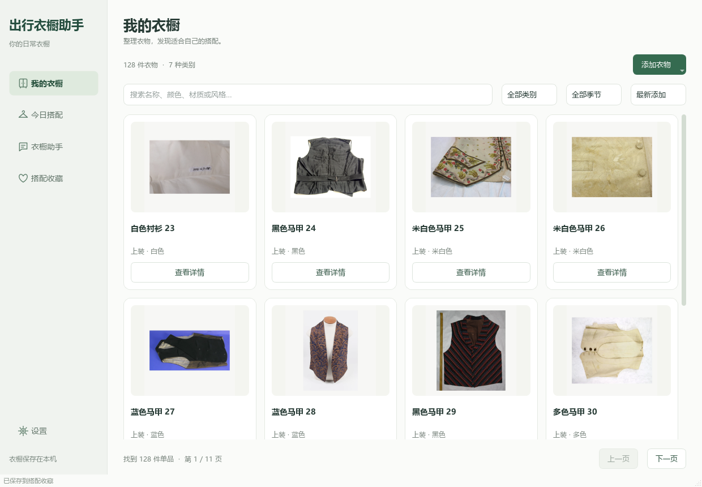
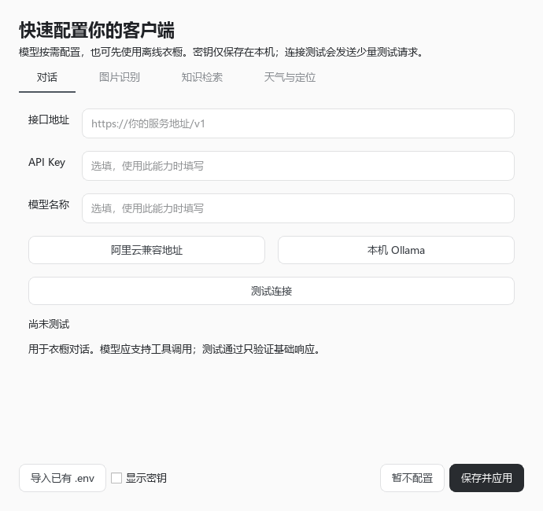

<div align="center">

# 出行衣橱助手

**整理衣橱，搭好今天，准备下一次出行。**

本地优先的 Windows 便携桌面助手 · 衣物管理 · 天气穿搭 · 旅行行李 · AI 洗护问答

[](https://github.com/yinzuosheng741-wq/StyleMate/actions/workflows/ci.yml)
[](LICENSE)


[快速开始](#快速开始) · [功能](#功能) · [服务配置](#服务配置) · [开发与验证](#开发与验证) · [贡献](CONTRIBUTING.md)

</div>



> 当前为开发预览版，独立分发包已在本机 Windows x64 验证。Linux CI 用于源码回归，不代表已提供 Linux / macOS 安装包。界面、API 基础连接和业务准确率是不同的验证范围，详见[核验报告](docs/PROJECT_AUDIT_20261030.md)。

## 为什么做这个项目

衣橱里有衣服，出门前依然会犹豫：今天的天气穿什么、旅行三天带哪些、这件衣物该怎么洗。出行衣橱助手把真实衣物库存、个人偏好、天气和知识来源放在一个窗口里，帮助完成从整理到出门准备的流程。

项目原名 StyleMate。Python 包名与已有数据库文件名保留，以兼容既有衣橱；产品界面使用新的中文名。

## 功能

| 场景 | 可以做什么 | 服务要求 |
| --- | --- | --- |
| 整理衣橱 | 照片卡片、名称/颜色/材质/风格搜索、类别季节筛选、排序分页、详情编辑与删除 | 离线可用 |
| 添加衣物 | 手动录入，或识别照片后编辑草稿并确认入库 | 手动离线；识别需视觉模型 |
| 今天怎么穿 | 根据真实库存、场景、季节和排除条件生成搭配并收藏 | 规则离线；实时天气可选 |
| 出行准备 | 在对话中说明目的地、天数、活动和限制，获取旅行行李与穿搭建议 | AI 对话和实时天气可选 |
| 洗护与知识 | 查询带来源的知识摘要，添加当前会话的 PDF/TXT/Markdown 资料 | 关键词检索离线；向量可选 |
| 对话与资料 | 历史会话、草稿恢复、资料管理、Markdown 对话导出 | 离线存储；模型回答需配置 |
| 本地数据 | 偏好设置、JSON 清单导出、含数据库与照片的 ZIP 备份 | 离线可用 |

衣橱写操作先展示修改前后内容，确认后才执行。搭配只使用当前库存，规则分数仅用于候选排序。出行能力聚焦衣物、天气与行李准备，暂不提供路线导航、订票或酒店预订。

## 快速开始

### Windows 便携客户端

1. 获取项目公开构建产物 `TravelWardrobeAssistant-Windows-Portable.zip`。
2. 完整解压到可写目录，双击 **`出行衣橱助手.exe`**。
3. 首次启动配置模型与天气服务，也可点击“暂不配置”，直接使用离线衣橱。

软件已包含 Python、Qt 和运行依赖。不要只复制 exe；退出后整个文件夹可迁移到另一台电脑。首次运行初始化 128 件演示衣物；已有数据不会被覆盖，已删除的演示衣物不会在重启时恢复。

**获取构建产物**：查看仓库 [Actions](https://github.com/yinzuosheng741-wq/StyleMate/actions/workflows/desktop-release.yml)，运行 `Build Windows Desktop` 后下载产物；维护者可将其中的 ZIP 上传到 Releases。GitHub 源码 ZIP 不包含 exe，本文不把尚未发布的 Release 当成可下载版本。

### 从源码运行

要求 Python 3.11 或 3.12，以下使用 PowerShell：

```powershell
git clone https://github.com/yinzuosheng741-wq/StyleMate.git travel-wardrobe-assistant
cd travel-wardrobe-assistant
python -m venv .venv
.venv\Scripts\python.exe -m pip install -r requirements.txt
.venv\Scripts\python.exe desktop.py
```

安装依赖后，也可双击 `Start.vbs` 隐藏控制台启动，或运行 `Start.cmd` 查看诊断输出。`requirements-desktop.txt` 和 `requirements-portable.txt` 均引用默认原生运行依赖。

## 服务配置

从首次启动向导，或“设置 → 服务状态 → 配置模型、天气与定位”打开配置窗口。各能力可以分别启用，修改后保存即可应用。



| 能力 | 填写内容 | 选型要求 |
| --- | --- | --- |
| 对话 | 兼容接口地址、API Key、模型名称 | 模型应支持工具调用；也可接本机服务 |
| 图片识别 | 视觉接口地址、Key、模型名称 | 必须支持图片输入 |
| 语义检索 | 向量接口地址、Key、模型名称 | 必须是 Embedding 模型，不能填对话模型 |
| 高德天气 | 自己的 Web 服务 Key、默认城市 | 城市名称会解析为行政区编码 |
| Open-Meteo 天气 | 默认城市，无需 Key | 免费接口限非商业使用，有限额及可用性限制 |

图片与向量页可复用对话的地址、密钥；三个模型名称分别填写。支持导入已有 `.env`，包括常见 OpenAI-compatible / DashScope / 高德密钥别名。连接测试发送少量请求，视觉测试使用生成色块，不上传个人衣橱照片。

IP 城市定位**默认关闭**，手动指定城市即可查天气。主动开启后，高德可在未指定城市时通过网络出口 IP 推测城市；结果可能受 VPN 影响，不等同于 GPS。可随时关闭在线天气。

“已配置”只表示填写了配置。连接测试验证基础响应，不保证模型工具调用或衣物识别准确率。免费接口条款见 [Open-Meteo](https://open-meteo.com/en/pricing)，完整说明见[便携版指南](docs/PORTABLE_20261030.md)。

## 数据、隐私与备份

| 位置 | 内容 |
| --- | --- |
| `data/stylemate.db` | 衣物信息、偏好、收藏、会话与资料 |
| `data/uploads/` | 衣物照片 |
| `data/config/services.env` | 本机私有服务配置 |
| `data/desktop/ui.ini` | 草稿、窗口位置和上次会话 |
| `data/knowledge/` | 内置带来源的知识记录 |

默认保存在程序目录，不要求注册本项目账号。启用外部模型、向量、天气或定位时，相应输入会发送到你选择的服务；本地存储不等于所有功能均不联网。

密钥在 UI 中遮挡，配置文件本身**没有加密**。不要公开使用过的个人目录；公开构建包不包含开发者密钥、数据库或草稿。

“创建完整备份”生成数据库在线快照、关联照片及 SHA-256 清单，不包含密钥、界面状态或向量缓存。JSON 清单只是衣物元数据导出，不能代替备份。恢复与升级见[客户端指南](docs/DESKTOP.md)。

## 开发与验证

```powershell
.venv\Scripts\python.exe -m pip install -r requirements-dev.txt
.venv\Scripts\python.exe scripts/validate.py
```

统一验证执行依赖检查、知识和素材审计、Ruff、编译、测试和固定评测质量门槛，输出到 `artifacts/validation/`。测试默认阻断联网，使用隔离数据；真实服务检查单独执行，不把开发者密钥交给 CI。

Actions 配置了 Linux 与 Windows 源码测试。徽章展示远端状态；本地证据及实际限制见[核验报告](docs/PROJECT_AUDIT_20261030.md)，本地通过不能代替尚未运行的远端 CI。

最新的完整使用流程、真实接口复测及缺陷修复记录见[功能测试报告](docs/FUNCTIONAL_TEST_20261030.md)。

Windows 打包：

```powershell
.venv\Scripts\python.exe -m pip install pyinstaller==6.11.1
.venv\Scripts\python.exe scripts/build_desktop.py
```

输出目录 `dist/native/出行衣橱助手/`，公开 ZIP 为 `dist/TravelWardrobeAssistant-Windows-Portable.zip`。旧输出存在个人配置或数据库时拒绝覆盖。`portable-lock.txt` 是特定 Windows / Python 环境快照，不作为跨平台锁文件。

## 架构

```text
Qt 原生界面 → 业务服务 → SQLite / 照片 / 会话资料
                    ├─ 确定性穿搭与库存约束
                    ├─ 有界 LangGraph → 模型与工具 → 写操作确认
                    └─ 知识检索 → BM25 / 可选向量 → 来源
```

`desktop/` 为页面、配置和备份；`services/` 为应用服务；`agent/` 为编排、工具与记忆；`repositories/` 为存储；`rag/` 为检索；`rules/` 为确定性规则；`evaluation/` 和 `tests/` 保存评测及回归用例。工具使用有界线程池、超时和调用预算；写操作通过带有效期的快照确认，见[框架说明](docs/FRAMEWORK_MAINTENANCE_20261029.md)。

## 已知限制与常见问题

- **没有模型 Key？** 可管理衣橱、手动录入、规则搭配和关键词检索；照片识别需要视觉服务。
- **接口返回 401 / 404 / 429？** 分别检查密钥授权、接口路径或模型名称、额度或限流；设置页可测试连接。
- **备份失败？** 检查目录权限、剩余空间及照片是否缺失。失败时保留已有备份。
- **云同步、多用户、自动更新？** 暂不支持。当前聚焦单用户，同一数据目录限制一个客户端实例。
- **回答准确率？** 不作保证。检索题集的本地 Hash Embedding 基线 Recall@5 为 0.2389，存在证据不足和历史题目范围冲突；固定门槛只阻止已知回归。护理建议以该件衣物洗标和品牌说明为准。

后续方向：提高已审核知识覆盖及检索质量、扩充独立业务验证、改进出行准备体验。未完成的方向不写成现成功能。

## 贡献与许可证

欢迎提交可复现的 Bug、交互改进和带官方来源的知识修订。见[贡献指南](CONTRIBUTING.md)和 [安全说明](SECURITY.md)。报告时不要上传密钥、个人照片或完整私有配置。

项目代码采用 [MIT](LICENSE)。第三方组件与素材保留各自许可，见 [THIRD_PARTY_NOTICES.md](THIRD_PARTY_NOTICES.md)。演示图片来自 Auckland Museum / Wikimedia Commons，CC BY 4.0，见[逐项来源](assets/demo/SOURCE.md)；演示数据不作为识别准确率测试集。

界面组织参考 [LocalSend](https://github.com/localsend/localsend) 和 [Files](https://github.com/files-community/Files)，实现采用自己的 Qt 页面、图标和主题。
