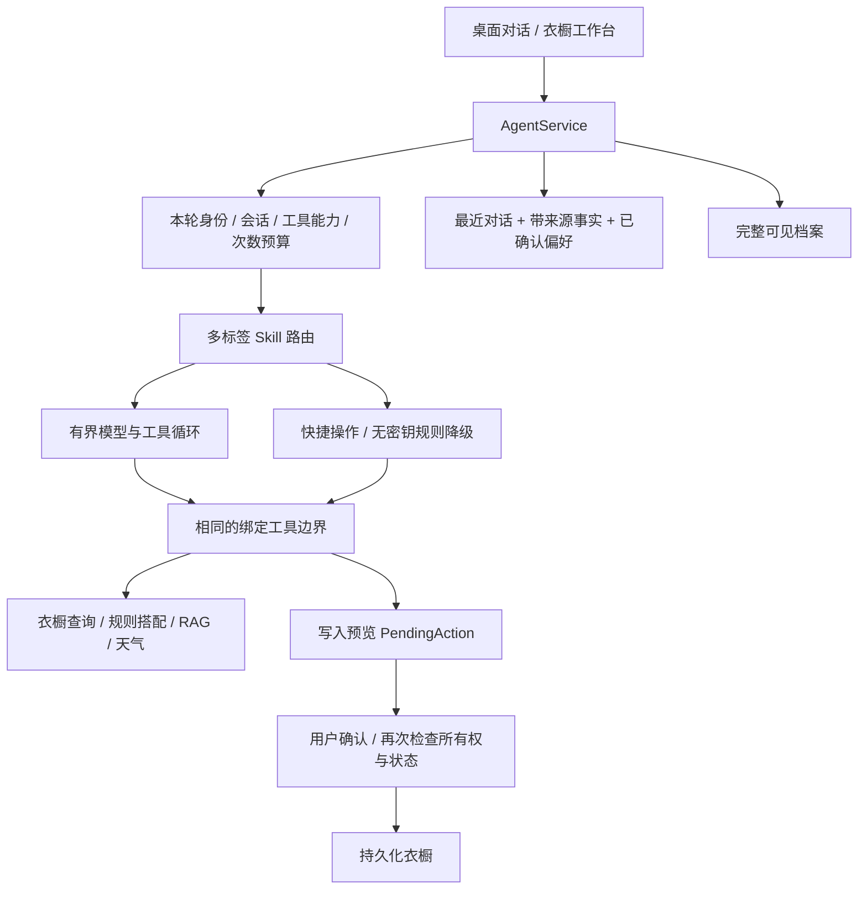

# 第二轮架构复盘与实现（2026-10-22）

这次重点是让 Agent 工具循环可靠、权限覆盖全部业务入口、记忆可查看和遗忘，并建立独立的桌面对话布局。当前仍为单用户本地应用，UI 使用 Streamlit，桌面外壳为 pywebview。

## 当前链路

## 已实现

| 层 | 发现的问题 | 当前处理 |
|---|---|---|
| Agent | 将所有工具结果统一追加到消息末尾，第二轮工具调用可能违反协议顺序 | 保留完整当前调用链，仅裁剪之前的普通对话；工具结果紧跟对应 assistant 调用 |
| 工具权限 | 原先路由检查主要在图节点中，快捷/规则入口没有相同请求预算 | AgentService 绑定 RequestPolicy；读工具和写入预览闭包都检查 owner、conversation、允许工具、次数和截止时间 |
| Skill | 工具集合与任务路由混杂 | 保持多标签 read skill 联合召回；写操作仅开放本轮明确意图对应的预览工具；最终写入仍需确认 |
| 记忆可信度 | 用户偏好、抽取事实放进系统消息，容易模糊优先级 | 以结构化用户数据进入上下文；系统消息仅承载可信规则；数据不能提升工具权限 |
| 记忆生命周期 | 有来源和 TTL，但缺少遗忘入口 | 提供事实来源/有效期、单项长期偏好遗忘、会话上下文重置；重置同时撤销待执行操作 |
| 历史记录 | 最近 8 条上下文也是 UI 历史，旧内容被裁掉 | transcript 保存完整可见档案，messages 保持最近 8 条；旧数据在保存时兼容迁移 |
| 前端 | 悬浮衣橱侧栏样式影响独立桌面对话区域 | 桌面对话使用独立容器样式、历史搜索/切换、底部输入框和资料入口；衣橱工作台保持业务布局 |

本地模式存 SQLite；演示模式只存当前窗口。旧版本已经裁掉的历史无法恢复。遗忘上下文会保留可阅读档案，但不再把这些旧消息和事实带到模型；长期偏好和会话上传资料分别管理。若要阻止此前偏好通过最近对话再次出现，应同时重置会话上下文或新建对话。

## 需要保持的边界

- 路由只决定候选工具；工具参数 schema 不提供 owner_id/conversation_id 覆写入口。工具闭包绑定真实上下文，执行前再检查，避免只在提示词中描述权限。
- 所有公开 chat 请求，包括快捷与降级路径，都使用同一个 RequestPolicy。直接调用底层库属于可信内部使用，不提供网络鉴权；后续服务化必须在 API 边界强制绑定策略。
- 默认预算为每轮最多 4 次模型调用、6 次逻辑工具调用。网络只读重试仍由工具 middleware 控制。截止时间检查不能强杀已运行线程，不能把它描述为彻底取消远程请求。
- 检索只使用内置知识和当前 owner/conversation 的上传资料；RAG 内容不进入写入确认链。照片、资料文本和工具结果都不能自行授权执行变更。
- 规则 Skill 负责天气、库存、排除条件和搭配约束；LLM 负责解释和编排。增加 Agent 数量前，应先证明单个工具链和失败降级满足业务约束。

## 下一步优先级

1. **真实查询与分层评测**：保留固定离线集，另建用户真实问题留出集，分开看词法、语义、会话资料、图片衣物检索。现有 Hash embedding 固定测试不能替代真实 embedding 评测。
2. **图片与属性联合召回**：衣物图片 embedding、品牌/颜色/材质/季节结构化过滤，并把用户确认的识别修正回写索引。先收集近似衣物难例，再决定是否部署多模态模型。
3. **偏好与反馈**：显式记录喜欢/不喜欢、原因与时间；排序考虑库存、天气和可解释的偏好权重，避免将一次旅行要求永久固化为用户偏好。
4. **Skill 注册表**：把版本、输入 schema、工具能力、数据范围和评测用例集合统一描述，启动时校验引用工具存在；再做受控插件加载。当前不支持运行用户随意上传的可执行 Skill。
5. **任务与界面**：增加可取消的后台任务、事件流、逐步进度、会话重命名/导出；档案较大时改成逐消息存储与分页。服务层稳定后再迁移独立前端，减少业务代码与页面状态耦合。

交互参考：[ChatGPT 会话查找说明](https://help.openai.com/en/articles/10056348-finding-your-chats-projects-and-files-in-chatgpt)。本轮实现了历史侧栏和专注对话布局，没有声称已具备完整 ChatGPT 客户端的流式、语音或跨设备同步能力。

## 验证

本轮完整测试 222 通过，Ruff 检查通过。101 条离线评测中混合 Recall@5 为 95.00%，MRR@5 为 98.06%，与上一轮相同；20 条图执行用例的路径、契约、写入确认、循环上界检查全部通过。报告位于 `artifacts/agent_evaluation_20261022_round2.json`。Hash embedding 下 BM25 的 Recall@5 仍高于融合，因此应先用真实 embedding 与独立留出集验证，再决定融合权重。

覆盖多轮工具协议顺序、记忆不进入系统指令、直接工具调用越权拦截、预算耗尽、会话遗忘不恢复旧事实，以及真实 Streamlit 新建/切换/遗忘交互。浏览器在 1360×980 和 900×700 下检查。测试无需付费模型，不能据此宣称真实模型回答质量或召回率提高。
