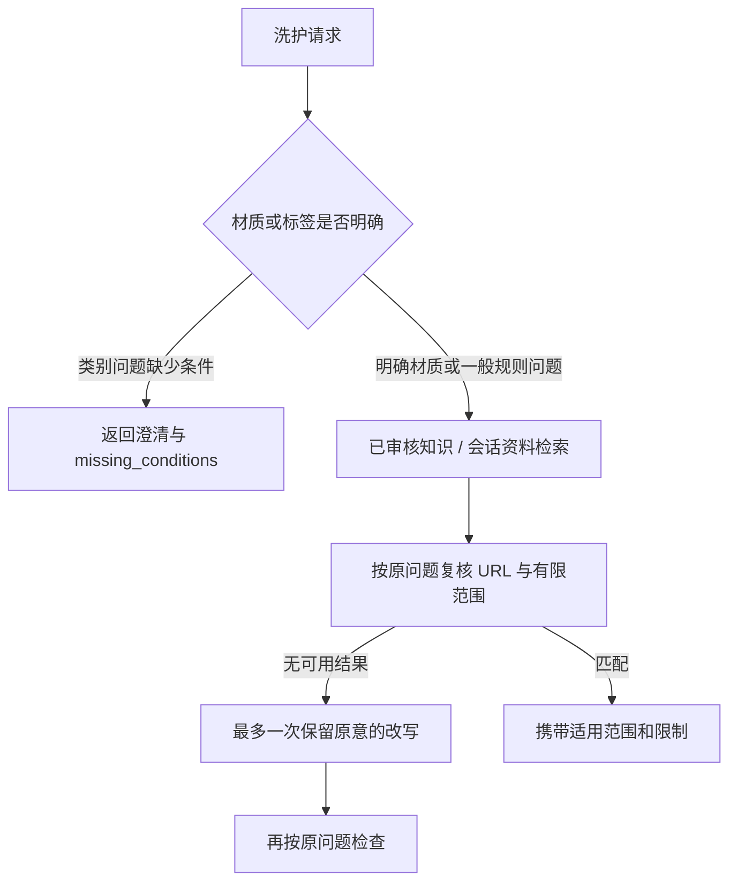

# 洗护范围、澄清与历史指标取舍

日期：2026-10-28。本批改善实际工具结果的使用范围，不增加知识条目，也不声称召回和答案质量全面提高。

## 1. 真实问题

旧改写把“毛衣”替换成“羊毛衣物”。毛衣或针织描述的是衣物类别，不能据此确认纤维。通用冲锋衣问题也可能检索到 GORE-TEX 专属规则。即使来源真实，适用对象仍可能不匹配。

## 2. 当前执行链路

- `care_guide` 返回 answer_status=needs_clarification、missing_conditions=[material_or_care_label]、空 results/sources。该分支不调用检索器。
- 已给出“羊毛”等材质后仍走既有带来源检索；缺少品牌尺码、护理程序或标签许可时，来源范围和限制继续有效。
- 洗标含义、分类、污渍、收纳、用量等一般规则问题不强制要求先猜材质。
- 去掉“毛衣→羊毛”的改写。检索器及 Skill 最终边界都根据原问题检查，改写不能改变材质或主题范围。
- 未明确品牌的冲锋衣技术问题不返回 GORE-TEX 专属资料，也不以无关的普通洗衣摘要填充空结果。
- 用户上传标签可通过原有会话文档检索通道查询；其来源标记不被当作权威认证。隔离仍由仓储/检索层的 owner/conversation 校验负责。

这是有限词法规则。它不理解所有否定、混纺描述和隐含指代，也不会自动把模糊问题绑定到衣橱中的某件衣物。

## 3. 历史标签冲突透明保留

知识仍为 17 条已审核摘要、21 条项目启发、26 条待审核。原 60 条检索题与全部分母保持不变，Embedding 仍为 offline_hash。

| 指标 | 上一批 | 本批 |
| --- | ---: | ---: |
| 历史标注 ID 完整可用 | 15/60 | 15/60 |
| 当前有限范围规则也兼容 | 未单列 | 12/60 |
| 混合 Recall@5 | 27.22% | 21.39% |
| 混合 MRR@5 | 25.14% | 19.72% |
| 混合 nDCG@5 | 24.64% | 19.57% |

冲突题为 shell-beading、shell-maintain、para-shell。旧标签要求通用外套问题直接命中品牌技术摘要；当前策略选择先确认适用对象，拒绝这些不带限定的引用。这里记录的是策略与历史标注的冲突，不宣布所有旧标签已经专家复核为错误，也不删除题目以提高分数。

当前报告为 `artifacts/agent_evaluation_care_scope_release_20261028.json`，manifest 已指向它。knowledge_coverage 增加 scope_compatible_fully_covered_cases 和 scope_incompatible_case_ids，区分 ID 存在与范围适配。关于页面的旧覆盖字段来自历史标签 ID 可用性，不能解释为最终回答完整可用；原文语义支持仍需另外标注。

## 4. 验证

新增 14 项回归，覆盖未知类别先澄清、原问题范围复核、改写不推断纤维、会话文档仍可检索、三种召回模式面对错误高向量相似度时的范围检查，以及真实对话“先澄清、再补材质”。

本地全量 331 项通过，Ruff 全量及健康检查通过；保留一条既有第三方弃用提示。未调用付费模型或真实 embedding，没有以这些测试数代替实际用户回答准确率。

下一步需要独立复核冲突题、标明一般原理与特定产品的边界，再评价模型是否正确追问和使用用户补充的标签。条件具备时再接入指定衣物 ID 的材质读取，不能让模型猜用户指的是哪件衣物。
