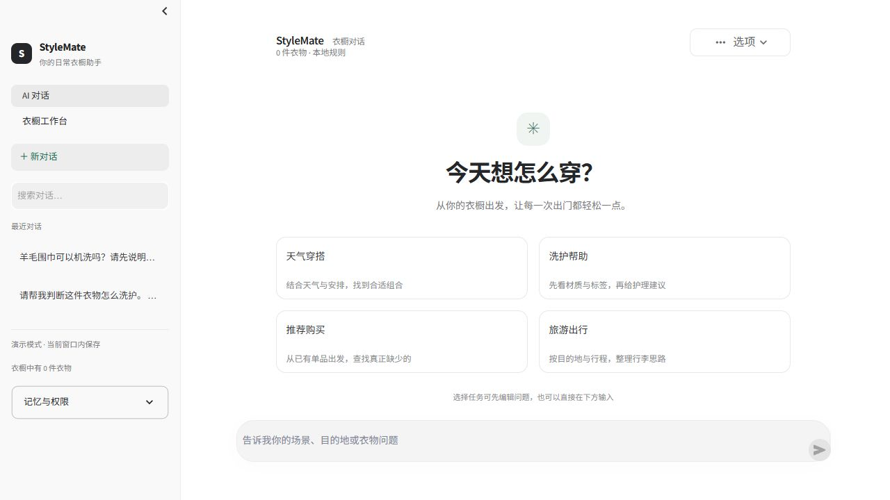

# 桌面界面与任务交互精修

日期：2026-10-27，接续同日第一批工作区优化。

## 产品与交互

界面参考 ChatGPT / Codex 的低干扰侧栏、居中正文、底部输入和渐进式操作入口，保留衣橱业务本身。新增统一的中性色、260px 侧栏、轻选中态、用户消息气泡、任务说明卡和选项菜单。CSS 独立保存在 `stylemate/ui/desktop.css`，不依赖远端字体、图片或脚本。

- 桌面对话的四个任务入口先生成可编辑草稿，分别提示场景/温度/排除条件、材质/洗标、购买场景/预算和旅行目的地/天数。点击入口不会调用 Agent；编辑后明确发送才执行。
- 草稿为空时阻止发送，取消不执行，新建或切换对话清除草稿；失败时保留编辑内容，发送成功后恢复普通输入。任务草稿存在时禁用普通输入，避免两个入口同时提交。
- 对话选项支持导出当前完整可阅读历史、来源记录与搭配记录，遵循当前衣物归属解析，删除的单品标为已不在衣橱。导出不包含工具执行载荷、记忆或上传文件全文；文字经过 HTML/Markdown 转义。
- 衣橱工作台采用独立全宽布局，避免衣物卡片与固定聊天栏争抢空间。默认网页模式保留原有入口；桌面启动方式仍是 Streamlit + 既有本地启动器。
- 保留原生控件的键盘操作，增加可见焦点和减少动画偏好支持；修正长历史标题截断、初始页头被自动滚动遮住的问题。

## 验证

本地全量 299 项通过，Ruff 和健康检查通过。最终任务模板调整后，对话与草稿相关 11 项再次通过。新增回归覆盖：编辑后才发送、空草稿、取消、新建清理，以及遗忘模型上下文后仍可导出档案和正确标记失效衣物。浏览器使用演示会话、关闭付费模型，验证实际任务草稿与本地洗护回复；这不是模型回答质量评测。

本批没有扩充知识或调整检索算法，不报告召回率提升。后续优先推进知识来源核验、真实检索评测及单品替换与反馈。

