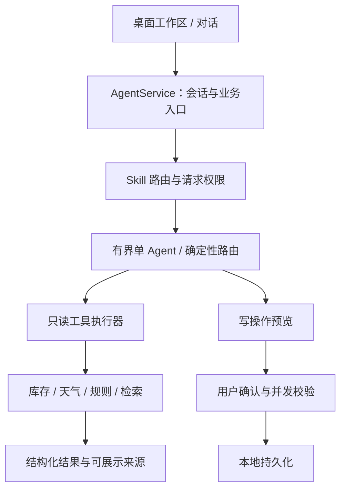

# StyleMate：以业务边界为中心的框架演进

日期：2026-10-27。本批修改执行层，不调整界面、不扩充知识库，也不声称召回率或真实模型回答准确率提升。

## 1. 高星项目对标与取舍

访问时 GitHub 页面近似显示 LangGraph 44.0k、Dify 159.7k、RAGFlow 93.0k stars。星数仅用于选择调研对象，不作为技术适用性或质量结论。

| 官方参考 | 可借鉴的机制 | 本项目的决定 |
| --- | --- | --- |
| [LangGraph 重试和超时类型源码](https://github.com/langchain-ai/langgraph/blob/main/libs/langgraph/langgraph/types.py) | 重试次数、适用异常和超时各有明确契约 | 保留现有有界图，修复本地工具执行器；不因对标而升级依赖 |
| [Dify 失败处理](https://docs.dify.ai/en/cloud/use-dify/build/predefined-error-handling-logic) | 区分备用输出和失败分支 | 将工具失败说明传到业务入口，失败载荷不能继续当成天气事实 |
| [RAGFlow 官方说明](https://github.com/infiniflow/ragflow#readme) | 分块检查、来源回查、检索融合 | 延续知识审核与引用契约，后续用独立标注评价检索，当前不迁入整个平台 |
| [LangGraph 持久化](https://docs.langchain.com/oss/python/langgraph/persistence) | 会话状态与跨会话记忆分别管理 | 保留对话事实、用户确认偏好与待确认操作的独立语义；未新增 checkpoint 服务 |

以上是对机制的取舍，不复制上游实现，也不宣称已经实现这些项目的全部能力。

## 2. 适合衣橱业务的分层

模型选择任务与工具；库存归属、衣物约束、知识适用性和写入事务仍由代码决定。天气、规则和衣橱不是独立 Agent：它们没有各自推理循环，作为业务服务更容易验证。

## 3. 本批真实缺陷与修复

### 3.1 超时不是线程结束

旧执行器等待 `Future` 超时后，会按 retry_once 再次启动线程；原线程可能仍在运行。

现在区分两种情况：

- 等待超时或任务本身抛出通用 TimeoutError：立即返回失败，不重叠重试，不接收迟到结果。
- 已结束调用抛出 requests 网络超时/连接异常：仅显式允许重试的只读工具可再试一次；重试前再次检查请求剩余时间。

每次等待上限为 `min(工具等待上限, 请求剩余时间)`；返回后再次检查请求截止时间。工作线程通过 copy_context 继承当前请求策略，避免在线程边界丢失 ContextVar。

只读执行器拒绝 permission=write_prepare 的规格。写预览和用户确认继续走原有独立通道，不自动重放。

### 3.2 一次天气工具结果驱动完整业务

原天气穿搭与旅行流程先执行 get_weather，随后又直接调用 weather_client.weather。第二次调用绕开工具权限和等待边界，并可能得到不同天气。

现在两个流程都复用同一次工具返回的成功结构化载荷：

1. 受控天气调用。
2. 展示天气摘要。
3. 只有成功且 available=true，才把城市、温度、天气传给穿搭/行李服务。
4. 权限拒绝或失败后，保留未知天气，不直接调用提供方补取。

`_invoke_named` 管调用，`_present_named` 管展示，业务组合无需从中文回复中反解析天气。

## 4. 验证与边界

新增 10 项执行与业务回归：读写通道隔离、线程策略继承、截止时间前置拦截、真实线程迟到结果、等待超时不重试、网络重试受请求时间限制，以及两条业务入口各自的单次天气调用和权限拒绝不旁路。

本地全量 309 项通过，Ruff 全量与健康检查通过；一条既有 DashScope 弃用提示。测试使用替代天气客户端、受控事件和本地数据，不访问付费模型或真实天气接口。

必须保留的限制：

- Python 同步线程不能被强制终止；本批限制等待与重试，未实现进程级取消或全局工作线程隔离池。
- 请求截止时间属于执行边界检查，不是所有模型 SDK、SQLite 或本地库的强制中断器。
- 预算中的 tool calls 仍按逻辑调用计数；允许的单次网络重试最多产生两次底层尝试，且受剩余时间约束。
- 单用户本地的 owner/conversation 隔离不能称为完整多租户身份认证。
- 长期偏好仍来自既有用户确认流程；没有把检索文本或工具结果自动写成长期事实。

## 5. 后续按业务收益推进

| 顺序 | 工作 | 验收依据 |
| --- | --- | --- |
| 1 | 定向补齐洗护与面料的可核验知识 | 每条事实的来源章节、适用范围和限制，不以知识数量代替质量 |
| 2 | 标注任务草案并冻结独立留出集 | 来源/模板分组，缺失证据与冲突用例单列，报告保留全部题目分母 |
| 3 | 固定单品、替换单品与明确反馈 | 约束可满足性、库存归属、反馈撤回和历史展示一致 |
| 4 | 对真实 embedding/重排做对照 | 同语料同问题，比较 Recall、引用有效性、耗时和调用成本 |
| 5 | 确有长任务再引入持久任务状态 | 以中断恢复需求证明必要性；写操作重放必须具备幂等与确认语义 |

多 Agent 仅作为后续可对照的实验：只有独立任务可拆分、并发存储安全且质量收益超过额外延迟/费用时才引入。
