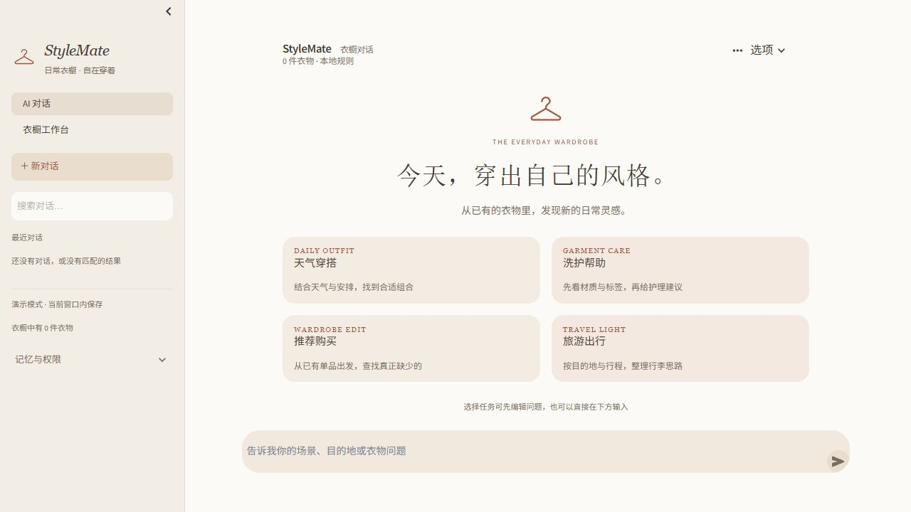

# StyleMate 视觉识别与控件精修

本批回应两个问题：重复描边让页面显得零碎；衣橱与文献项目共用过多视觉语言，不便演示辨识。

## 衣橱的独立风格

- 暖纸色背景、陶土色操作强调、浅米色导航，接近日常衣橱手记。
- 本地 SVG 衣架标识，品牌与欢迎区复用；标题采用本机衬线字体回退，业务正文仍使用易读的无衬线字体。
- 保留双列搭配、洗护、购买、旅行入口，用轻底色与用途说明组织信息；与文献项目的墨蓝侧栏、纵向任务列表区分。
- 库存单品与搭配结果沿用暖色无描边表面，缺图占位和真实衣物归属规则保持原流程。

## 减少边框

选项、导出、折叠区域及次要按钮减少常驻描边；输入框、选择框和草稿表单使用底色区分。发送等主操作保留明确强调色。悬停、可见键盘焦点和输入焦点仍有反馈，没有用隐藏焦点来制造“无边框”。

兼容本地旧版 BaseWeb 和文献项目新版 React Aria 的控件结构；不添加远端字体、图片或脚本。图标为项目内静态矢量代码，不把上传衣物当成界面装饰。

## 验证范围

现有 UI、状态及启动回归 19 项通过，Ruff、健康检查与差异格式检查通过。本批调整展示结构、样式和文案，不修改 Agent、RAG、工具授权或数据库结构，也不报告召回率变化。

实际浏览器检查欢迎页和草稿入口，确认取消后恢复普通输入；截图使用独立演示窗口并关闭外部模型与天气服务。

两项目均实际检查 430px 窄屏，页面宽度与视口一致，没有横向溢出。

