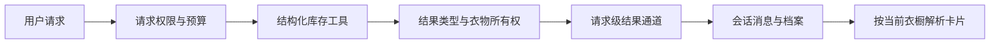

# 对话结果、桌面交互与验证设计

日期：2026-10-27。此批为现有 Streamlit 桌面工作区的增量完善。

## 实际变更

- 对话回复新增向后兼容的 `outfits` 字段，最多 3 个 OutfitRecommendation。旧会话没有该字段时按空列表读取。
- 已成功执行的库存搭配工具在可信工具边界收集结果，再次核对当前用户的衣物所有权；使用请求级 ContextVar，避免不同请求共用可变的服务实例结果。
- Agent 和确定性路由共用结果通道。模型文字不产生结构化衣物卡片；失败或无权限的调用不进入通道。历史对话展示时按当前用户衣橱重新解析 ID，已删除衣物不再显示为可用组合。
- 卡片组件使用消息 ID 区分重复推荐的控件，保留完整文字说明，并明确历史信息与规则评分的含义。缺少图片时显示品类占位，不生成虚构衣物照片。
- 工作台与聊天工具共用 `rules/guidance.py`，消除天气未知时一个入口推定薄衣、另一个入口保留未知的差异。
- 桌面界面收紧资料入口，采用中性侧栏、居中欢迎区、任务按钮及区分用户/助手的消息样式。430px 窄窗口检查无横向溢出。

卡片是只读候选结果，不替代衣橱变更的预览与确认。上下文发送给模型时继续使用已有消息文字；没有把图片字节或全量档案加入模型请求。

## 评测版本绑定

“关于”页原来固定读取旧 `agent_evaluation.json` 并显示 95% Recall@5。现在由 `artifacts/evaluation_manifest.json` 指定报告，展示前同时核对：

1. 规范知识文件 SHA-256（UTF-8 文本统一换行后计算，避免 Windows/Git/Linux 换行差异误报失效）。
2. 检索、图执行及路由/记忆/安全题集的 SHA-256。
3. 指标数值范围、有限性、计数类型和覆盖分母一致性。

版本不匹配时不显示历史指标；缺失、损坏或异常报告显示不可用状态。该校验确认的是文件版本与报告结构，不证明标注正确、来源权威或结论得到语义支持，也不校验任意代码版本。

当前报告为 `agent_evaluation_workspace_20261027.json`：历史 60 题完整证据覆盖仍为 10/60，混合 Recall@5 仍为 18.06%，使用 offline_hash。UI 明确标注它是确定性测试替身，不能当作真实 embedding/回答准确率。知识库仍有 33 条待核验，本批没有扩库。

## 验证与边界

- 296 项本地测试通过、1 条第三方弃用提示，Ruff 通过。
- 覆盖模型文字不能注入卡片、跨用户隔离、请求间结果清空、最大结果数量、重复推荐界面、语料/题集变更、异常指标和分母不一致。
- 实际浏览器核看欢迎页、导航、带约束的库存搭配与窄窗口。预览关闭外部模型与天气服务，使用演示库存，不代表真实模型联调。
- 源码快照打包检查成功，包含当前报告、manifest 和题集；未包含独立 Python 运行时，因此不作为新的完整便携安装包发布。
- Git 检出目录中的打包文件还需通过 Git 文件清单，避免把忽略的本地交接笔记或其他个人文件带入快照。无 Git 元数据的目录继续使用显式目录与扩展名排除规则。

后续优先补来源知识与独立证据标注，推进固定/替换单品、显式反馈和记忆撤回闭环。主架构保持单 Agent、任务 Skill 和确定性业务服务，未引入额外 Agent。
