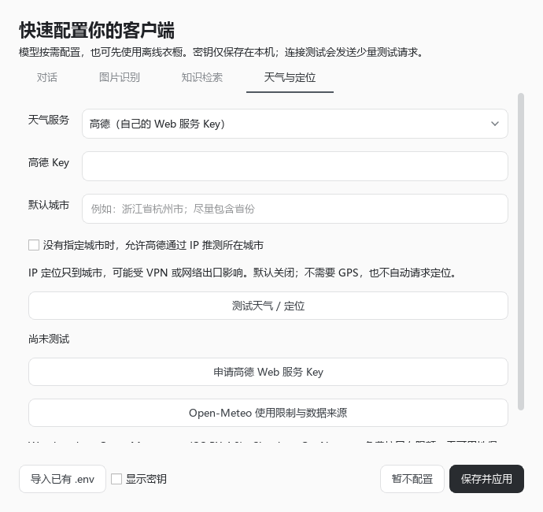

# 真正的便携版与服务配置

2026-10-30。

## 方案取舍

“融合代码”意味着统一启动、配置、数据和分发流程，业务仍按服务、Agent、存储和 Qt 页面分层。将所有逻辑塞进一个文件不会让软件更完整，也会增加维护成本。

便携版包含 Python 和 Qt，解压后运行 exe。衣橱数据库、照片、服务配置、窗口位置与草稿都在程序目录中；退出后整体复制即可迁移。程序需要放在可写目录。

公开包不能附带开发者模型或高德密钥。桌面程序中的共享 Key 可以被提取，会共同消耗额度；给文件加壳不能解决这个问题。若以后需要所有用户免配置使用付费能力，应另建具有身份验证、限额与计费的服务端代理，并承担运营成本。本版采用用户自己的 Key，保留离线能力。

## 第一次启动

向导包括“对话、图片识别、知识检索、天气与定位”四页。填写兼容接口地址、API Key 与相应模型名称；图片和向量页可复用对话连接。提供阿里云兼容地址与本机 Ollama 地址快捷填写，也支持导入已有 `.env`。本机模型服务可使用任意非空占位 Key，模型需先在本机安装并运行；软件不附带模型权重。

可以按需配置某个能力，也可暂不配置，先使用离线衣橱。保存后立即生效，后续可从“设置 → 服务状态”再次打开。连接测试使用少量请求，视觉测试发送生成的色块，既不上传衣橱照片，也不记录服务返回的完整错误内容。基础响应成功不等于模型工具调用、衣物识别准确率和全部业务均已验证。

## 天气与定位

- 高德：填写自己的“Web 服务 API”Key。天气查询使用行政区编码，城市名称先经地理编码解析。选择城市后不需要 IP 定位；不指定城市且主动开启定位时，才调用高德 IP 接口。IP 推测的是城市，VPN 或网络出口可能使结果偏离实际位置。[高德入门](https://lbs.amap.com/api/webservice/gettingstarted)、[天气接口](https://lbs.amap.com/api/webservice/guide/api/weatherinfo)、[IP 定位](https://lbs.amap.com/api/webservice/guide/api/ipconfig)。
- Open-Meteo：免 Key，可按城市查询，免费接口仅供非商业使用，有限额且无可用性保证；商业项目需购买相应授权。本版在设置中标明限制，并标注 Open-Meteo / GeoNames 数据来源，查询结果显示解析后的地区。城市同名时请填写省份或更完整名称并检查返回地区。[使用限制](https://open-meteo.com/en/pricing)、[城市搜索](https://open-meteo.com/en/docs/geocoding-api)。
- 关闭在线天气：继续使用季节、场景和库存规则。

成功的显式城市天气查询缓存 10 分钟，减少重复请求。不在不同服务之间自动切换，避免未经选择向其他服务发送查询。

## 文件与分发

| 路径 | 用途 |
| --- | --- |
| `出行衣橱助手.exe` 与同级依赖 | 完整客户端运行环境 |
| `data/stylemate.db`、`data/uploads/` | 衣橱、偏好、会话、文档与照片 |
| `data/config/services.env` | 本地私有服务配置，显式空值会禁用对应密钥，不回退到旧配置 |
| `data/desktop/ui.ini` | 草稿、上次会话、窗口状态 |

服务密钥以本地配置文件保存，UI 默认遮挡，文件未加密。该取舍允许跨机器携带；如需系统账户绑定的密钥保险箱，会影响跨电脑直接使用，应另外提供此模式。不要共享使用过的个人目录。衣橱 ZIP 备份不含服务配置与界面状态；完整自用迁移则复制整个目录。

构建命令 `python scripts/build_desktop.py` 同时生成干净目录和 `dist/TravelWardrobeAssistant-Windows-Portable.zip`，检查无 `.env`、数据库、INI 与私有服务配置，并校验 ZIP 完整性。如旧输出存在个人配置或数据库，拒绝覆盖。GitHub Actions 提供同样的验证与打包流程；发布时上传此干净 ZIP。

本机自用版在 `dist/personal/`，带本机配置和衣橱数据；公开版在 `dist/TravelWardrobeAssistant-Windows-Portable.zip`，不带这些内容。自用版不要上传 GitHub。

本机原有三个模型与高德天气已通过最小真实请求验证；IP 定位仍默认关闭。详细测试与分发记录见本地 `artifacts/portable-validation/`。GitHub 远端工作流需要提交推送后运行。

配置向导开发阶段统一验证通过 404 项测试，Agent 语句覆盖率 92.10%，固定规则与 Agent/RAG 质量门槛通过。新增回归覆盖配置迁移、密钥清空与优先级、目录移动、文件原子写入、地址校验、连接测试、免 Key 天气、定位关闭、缓存，以及服务热切换时保留会话和草稿。

公开版与自用版的独立 EXE 均完成数据初始化和窗口启动退出测试，退出码为 0；自用版保留本机 128 件衣物。公开 ZIP 通过 CRC 完整性检查，并用本机实际密钥做逐文件内容扫描，未发现密钥。构建后生成的公开目录测试数据已清理，原始个人数据保留。

